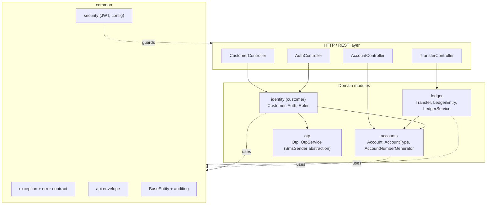
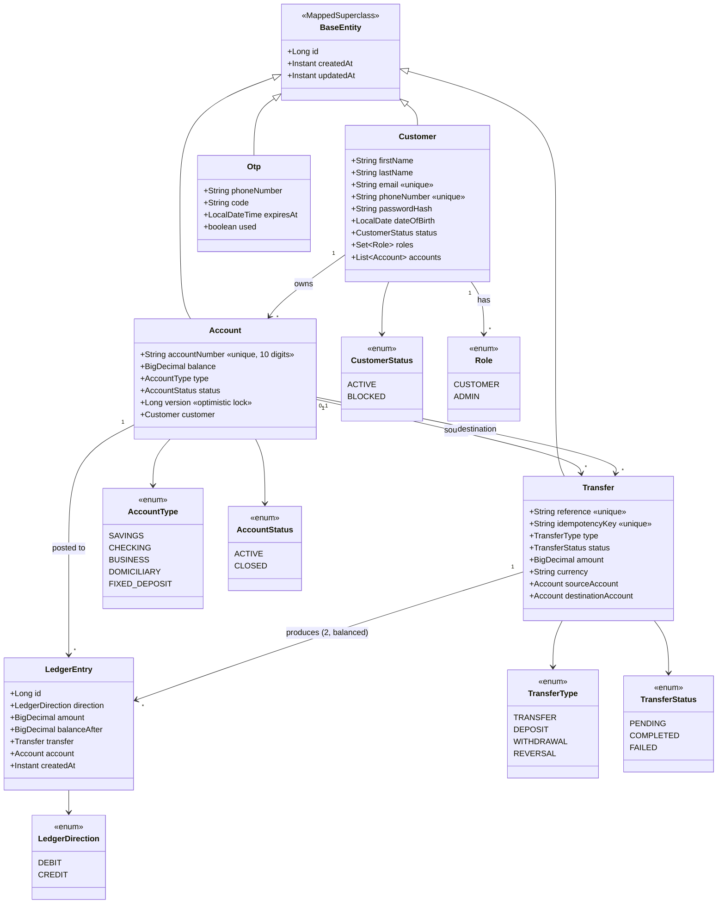
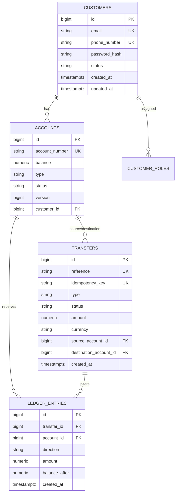
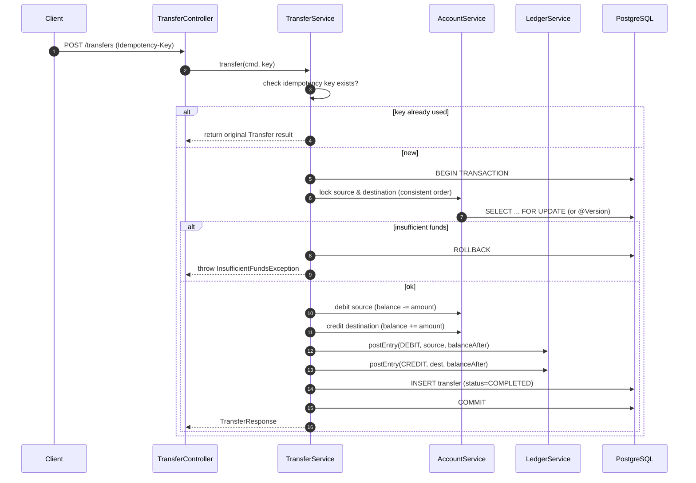
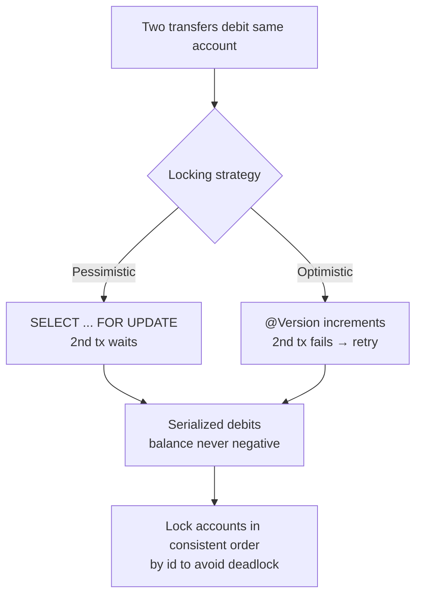

# SteviaBank — MVP 1 Implementation Plan

> A learning-driven, core-banking backend in **Java 17 + Spring Boot 4 + PostgreSQL**.
> Goal: build a **secure, double-entry ledger** where money moves with real correctness
> guarantees (atomicity, concurrency safety, idempotency). You write the code; this
> document is your map.

---

## 1. Project at a glance

| Aspect | Decision |
|---|---|
| Language / runtime | Java 17 |
| Framework | Spring Boot 4 (Web MVC, Data JPA, Validation, Security) |
| Database | PostgreSQL |
| Architecture | Modular monolith, package-by-feature, layered (controller → service → repository) |
| Money model | **Double-entry ledger**, immutable entries |
| Currency | Single currency (NGN) for MVP 1 |
| Scope | Internal transfers only; deposits/withdrawals are **admin/teller** actions |
| Auth | JWT access + refresh, BCrypt |
| Deferred to MVP 2+ | Reversals, interest/fees, GL chart-of-accounts, EOD reconciliation, external rails, multi-currency, outbox/events |

### Guiding principles
1. **Modules don't reach into each other's repositories** — call the other module's *service*.
2. **Money never moves outside one `@Transactional` unit** — no partial writes, ever.
3. **Every movement is immutable and auditable** — corrections are new entries, never edits.
4. **Every feature ships with at least one test.**
5. **Commit small and incremental** (one logical change per commit).

---

## 2. Target architecture

### 2.1 Module map (modular monolith)



**Rule of thumb:** `ledger` may call `accounts` (to lock/update balances) — never the
reverse. `identity` may call `accounts` (to open the first account) — never the reverse.
Arrows above show allowed direction of *service* calls.

### 2.2 Layered request flow

```mermaid
flowchart LR
    HTTP[Client] --> FILTER[JWT Auth Filter]
    FILTER --> CTRL[Controller\n@Valid DTO]
    CTRL --> SVC[Service\n@Transactional]
    SVC --> REPO[Repository]
    REPO --> DB[(PostgreSQL)]
    SVC --> MAP[map to Response DTO]
    MAP --> ENV[ApiResponse envelope]
    ENV --> HTTP

    SVC -.throws.-> EXC[BusinessException]
    CTRL -.throws.-> GEX[GlobalExceptionHandler]
    EXC --> GEX
    GEX --> ERR[ErrorResponse]
    ERR --> HTTP
```

---

## 3. Domain model (UML class diagram)



### 3.1 Ledger invariants (memorize these)
- A completed transfer produces **exactly 2** `LedgerEntry` rows: one `DEBIT` (source),
  one `CREDIT` (destination).
- `sum(DEBIT.amount) == sum(CREDIT.amount)` for every transfer → network delta is zero.
- `balanceAfter` on each entry equals the account balance immediately after posting.
- `Account.balance` is **derived truth** but **materialized** for fast reads; it must always
  equal `sum(CREDITS) - sum(DEBITS)` for that account.
- Entries are **append-only**; never update or delete a posted entry.

---

## 4. Data model (ER-ish)



> Note: for MVP 1 you may keep `roles` as a simple enum column on `CUSTOMERS`
> (`role`) instead of a join table — simpler, still correct. The diagram shows the
> more realistic normalized form.

---

## 5. API surface (MVP 1)

| Method | Path | Auth | Purpose |
|---|---|---|---|
| POST | `/api/v1/auth/register` | public | Register customer (OTP-verified), auto-open SAVINGS |
| POST | `/api/v1/auth/login` | public | Return access + refresh tokens |
| POST | `/api/v1/auth/refresh` | refresh token | New access token |
| GET | `/api/v1/customers/me` | CUSTOMER | Current customer profile |
| GET | `/api/v1/accounts` | CUSTOMER | List my accounts |
| GET | `/api/v1/accounts/{accountNumber}` | CUSTOMER (owner) | Account details |
| POST | `/api/v1/accounts` | CUSTOMER | Open additional account |
| GET | `/api/v1/accounts/{accountNumber}/transactions` | CUSTOMER (owner) | History + running balance |
| POST | `/api/v1/transfers` | CUSTOMER | Internal transfer (needs `Idempotency-Key`) |
| POST | `/api/v1/accounts/{accountNumber}/deposit` | ADMIN | Simulated cash-in |
| POST | `/api/v1/accounts/{accountNumber}/withdraw` | ADMIN | Simulated cash-out |

### Error contract (all endpoints)

```json
{
  "timestamp": "2026-01-01T12:00:00Z",
  "status": 422,
  "code": "INSUFFICIENT_FUNDS",
  "message": "Account 0123456789 has insufficient funds",
  "path": "/api/v1/transfers",
  "fieldErrors": []
}
```

### Success envelope (all endpoints)

```json
{
  "success": true,
  "message": "Transfer completed",
  "data": { "reference": "TRF-...", "status": "COMPLETED" },
  "timestamp": "2026-01-01T12:00:00Z"
}
```

---

## 6. Phase-by-phase plan

### Phase 0 — Foundations (refactor only, no new features)
- [ ] `common/persistence/BaseEntity` (`@MappedSuperclass`, `createdAt`, `updatedAt`)
- [ ] `common/config/JpaAuditingConfig` (`@EnableJpaAuditing`)
- [ ] Make `Customer`, `Account`, `Otp` extend `BaseEntity`
- [ ] `common/api/ApiResponse<T>` envelope
- [ ] `common/api/ErrorResponse` record
- [ ] `common/exception/ErrorCode` enum
- [ ] Custom exceptions: `BusinessException`, `ResourceNotFoundException`, `DuplicateResourceException`, `InvalidOperationException`, `OtpVerificationException`, `InsufficientFundsException`
- [ ] Fill `GlobalExceptionHandler` (validation → 400, custom → mapped, fallback → 500)
- [ ] Replace all `RuntimeException`s; remove `getString(request, isValid)` anti-pattern
- [ ] `modules/accounts/AccountNumberGenerator` (unique, collision-retry) + `existsByAccountNumber`
- [ ] Tests: register happy path, duplicate email/phone, invalid OTP, validation shape

**Exit criteria:** app compiles, tests green, existing endpoints return the envelope,
errors return `ErrorResponse`.

### Phase 1 — Identity & security
- [ ] `passwordHash` + `BCryptPasswordEncoder`
- [ ] Roles (`CUSTOMER`, seeded `ADMIN`); `CustomerStatus`
- [ ] `SecurityConfig` (stateless) + JWT auth filter
- [ ] `JwtService` (sign/verify access + refresh), `TokenService`
- [ ] `AuthController`: register, login, refresh
- [ ] `GET /api/v1/customers/me`
- [ ] Lock down all endpoints; ownership checks
- [ ] Tests: login success/fail, token refresh, forbidden access

### Phase 2 — Accounts
- [ ] Auto-open SAVINGS on registration (already partially present)
- [ ] `POST /api/v1/accounts` — open additional SAVINGS/CHECKING
- [ ] `GET /api/v1/accounts`, `GET /api/v1/accounts/{accountNumber}`
- [ ] `AccountStatus` (ACTIVE/CLOSED)
- [ ] Ownership + role checks
- [ ] Tests: list-own-only, cross-customer access → 403

### Phase 3 — Ledger & money movement (the core)
- [ ] Entities: `LedgerEntry`, `Transfer` (+ enums `LedgerDirection`, `TransferType`, `TransferStatus`)
- [ ] `Account.balance` materialized + lock strategy (see §7)
- [ ] `LedgerService.postEntry(...)` — the single choke point for balance mutation
- [ ] `POST /api/v1/transfers` with `Idempotency-Key`
- [ ] `POST .../deposit` and `.../withdraw` (ADMIN only)
- [ ] `GET .../transactions` with running balance
- [ ] Tests: happy path, insufficient funds (no partial state), concurrent transfers, idempotent retry returns original result, role enforcement

**Exit criteria (MVP 1 done):** two customers register → each has a savings account →
A transfers to B → balances + ledger both reflect it → parallel transfers can't overspend →
retrying doesn't double-charge → history shows correct running balance → unauthorized rejected.

---

## 7. The hard parts (system-design deep dive)

### 7.1 Why double-entry?
A single `balance` column can't tell you *why* it changed, and mistakes are unrecoverable.
Double-entry makes every movement self-balancing and auditable: the sum of all debits
always equals the sum of all credits. This is the defining trait of a core banking ledger.

### 7.2 Transaction boundaries
A transfer must be **one** `@Transactional` unit:



### 7.3 Concurrency: how to stop overspending



**Recommendation:** **pessimistic locking** (`SELECT ... FOR UPDATE`) for transfers —
simpler to reason about. Always acquire locks in a **consistent order** (e.g. by account id)
to prevent deadlocks. See §8 for the code sketch.

### 7.4 Idempotency: retries must not double-charge
- Client sends a unique `Idempotency-Key` header with each transfer.
- Before processing, check for a `Transfer` with that key:
  - **found + COMPLETED** → return the original result (200), do nothing.
  - **found + PENDING/FAILED** → return the current state (or a conflict).
  - **not found** → process, storing the key on the `Transfer` row (`unique`).
- The `unique` constraint on `idempotency_key` is your last line of defense against races.

---

## 8. Reference sketches (fill these in as you code)

> These are **starting points**, not finished code. Adapt names/imports to your tree.

### 8.1 Custom exception base

```java
public abstract class BusinessException extends RuntimeException {
    private final ErrorCode code;
    protected BusinessException(ErrorCode code, String message) {
        super(message);
        this.code = code;
    }
    public ErrorCode getCode() { return code; }
}
```

### 8.2 GlobalExceptionHandler shape

```java
@RestControllerAdvice
public class GlobalExceptionHandler {

    @ExceptionHandler(MethodArgumentNotValidException.class)
    public ResponseEntity<ErrorResponse> handleValidation(MethodArgumentNotValidException ex,
                                                          HttpServletRequest req) {
        var fieldErrors = ex.getBindingResult().getFieldErrors().stream()
                .map(f -> new FieldError(f.getField(), f.getDefaultMessage()))
                .toList();
        // build ErrorResponse(code = VALIDATION_FAILED, status = 400, ...)
        // return ResponseEntity.badRequest().body(response);
    }

    @ExceptionHandler(BusinessException.class)
    public ResponseEntity<ErrorResponse> handleBusiness(BusinessException ex,
                                                        HttpServletRequest req) {
        // map ex.getCode() -> appropriate HTTP status
    }

    @ExceptionHandler(Exception.class)
    public ResponseEntity<ErrorResponse> handleFallback(Exception ex, HttpServletRequest req) {
        // log ex, return 500 INTERNAL_ERROR (never leak stack traces)
    }
}
```

### 8.3 Pessimistic lock + balance update

```java
public interface AccountRepository extends JpaRepository<Account, Long> {

    Optional<Account> findByAccountNumber(String accountNumber);

    boolean existsByAccountNumber(String accountNumber);

    // Pessimistic write lock; caller MUST be inside a @Transactional method
    @Lock(LockModeType.PESSIMISTIC_WRITE)
    @Query("select a from Account a where a.id = :id")
    Optional<Account> findByIdForUpdate(@Param("id") Long id);
}
```

```java
// In TransferService, inside a @Transactional method:
// 1. resolve both accounts, reject self-transfer, same-currency check
// 2. lock in consistent order:
long first = Math.min(srcId, dstId);
long second = Math.max(srcId, dstId);
Account a1 = accountRepository.findByIdForUpdate(first).orElseThrow(...);
Account a2 = accountRepository.findByIdForUpdate(second).orElseThrow(...);
Account source = a1.getId().equals(srcId) ? a1 : a2;
Account dest   = a1.getId().equals(dstId) ? a1 : a2;
// 3. check funds: if (source.getBalance().compareTo(amount) < 0) throw new InsufficientFundsException(...);
// 4. apply balance changes
// 5. write 2 ledger entries
// 6. persist Transfer(COMPLETED) with idempotency key
```

### 8.4 AccountNumberGenerator

```java
@Component
@RequiredArgsConstructor
public class AccountNumberGenerator {
    private final AccountRepository accountRepository;
    private final SecureRandom random = new SecureRandom();

    public String generate() {
        String candidate;
        do {
            candidate = String.format("%010d", random.nextLong(1_000_000_000L, 9_999_999_999L));
        } while (accountRepository.existsByAccountNumber(candidate));
        return candidate;
    }
}
```
> Note: under high concurrency the `unique` DB constraint is the real guarantee;
> catch `DataIntegrityViolationException` and retry.

### 8.5 Idempotency check

```java
public TransferResponse transfer(TransferCommand cmd, String idempotencyKey) {
    return transferRepository.findByIdempotencyKey(idempotencyKey)
            .map(this::toResponse)          // replay: return original
            .orElseGet(() -> doTransfer(cmd, idempotencyKey));
}
```

---

## 9. Testing strategy

| Type | Tool | What it covers |
|---|---|---|
| Controller slice | `@WebMvcTest` + MockMvc | status codes, envelope, validation, exception mapping |
| Service unit | JUnit 5 + Mockito | business rules, idempotency logic, edge cases |
| Integration | `@SpringBootTest` + Testcontainers (Postgres) | real transactions, locking, ledger invariants |
| Concurrency | JUnit + `CountDownLatch` + ExecutorService | parallel transfers cannot overspend |

**Must-have MVP 1 tests**
- [ ] Duplicate email / phone → `DuplicateResourceException` → 409
- [ ] Invalid/expired/reused OTP → `OtpVerificationException` → 400
- [ ] Transfer success → 2 ledger entries, balances correct
- [ ] Transfer with insufficient funds → no balance change, no entries (atomic rollback)
- [ ] Concurrent transfers from one account → balance never negative
- [ ] Retrying with same `Idempotency-Key` → original result, no double-charge
- [ ] Customer cannot read another customer's account/transactions → 403
- [ ] Customer cannot call deposit/withdraw → 403

---

## 10. Commit / workflow conventions

- Commit after **every** self-contained change (function, fix, refactor, config, test).
- Message style: `feat:`, `fix:`, `refactor:`, `chore:`, `test:`, `docs:`.
- Inspect `git status` / `git diff` before committing; stage only intended files.
- Never commit secrets, `.env`, or credentials. Keep proxy settings out of commits if
  possible (they are already in `gradle.properties` — be mindful).

---

## 11. Recommended learning resources (mapped to phases)

- **Phase 0–2:** Spring Guides, Baeldung (JPA, validation, `@ControllerAdvice`, Security + JWT).
- **Phase 3 (model):** Martin Fowler — *Accounting Patterns* (Account/Transaction/Entry/Posting Rule); study **Apache Fineract**.
- **Phase 3 (implementation):** tutorials on `@Transactional` propagation/isolation, pessimistic vs optimistic locking, "fund transfer race condition".
- **Cross-cutting:** *Designing Data-Intensive Applications* (idempotency, consistency), *Patterns of Enterprise Application Architecture*.
- **Phase 5:** Spring Modulith, transactional outbox pattern, *Enterprise Integration Patterns*.

---

## 12. Glossary

| Term | Meaning |
|---|---|
| **CIF** | Customer Information File — the customer master record |
| **CASA** | Current Account / Savings Account |
| **Double-entry** | Every movement has equal debits and credits |
| **Posting** | Writing a ledger entry |
| **Idempotency key** | Client-supplied token ensuring a retried op runs once |
| **Pessimistic lock** | DB row locked for the duration of a transaction |
| **Optimistic lock** | Version check on write; retry on conflict |
| **Outbox pattern** | Reliably publish events alongside a DB transaction |
| **EOD** | End of Day batch processing (deferred) |

---

## 13. Deferred (MVP 2+) backlog

- Transfer reversals / refunds (compensating ledger entries)
- Interest accrual, fees, product configuration per account type
- General Ledger chart-of-accounts + EOD reconciliation
- External/interbank transfers (NIP), cards, ISO 8583 rails
- Multi-currency + FX
- Pagination/filtering polish, OpenAPI/Swagger, rate limiting
- Flyway migrations, Actuator, correlation IDs, structured logging
- Transactional outbox + domain events, async SMS/email provider
- Optional service extraction (ledger or identity)